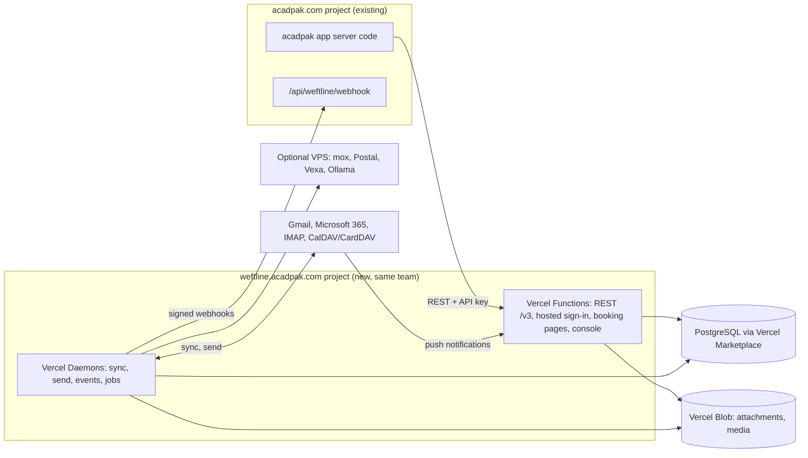

# Weftline

Weftline is a self-hosted, unified API for email, calendar, contacts, scheduling, meeting notes
and agent mailboxes. It speaks the v3 wire format, so apps already written against the
MIT-licensed v3 SDKs switch to Weftline by changing one base URL. This README covers running
Weftline for **acadpak.com** on the same Vercel team that hosts the acadpak.com site.

> **Status: specification, not yet built.** This repository holds the deployment design and the
> [API reference](docs/api/README.md). The server code is being built in five releases (R1 to R5,
> see [Roadmap](#roadmap)). Commands below that start with `npm run` or `npx weftline` describe
> the planned tooling and don't work until R1 ships.

## Contents

- [What Weftline does](#what-weftline-does)
- [How it runs on Vercel](#how-it-runs-on-vercel)
- [Vercel plan and costs](#vercel-plan-and-costs)
- [Deploy to acadpak.com](#deploy-to-acadpakcom)
- [Configuration](#configuration)
- [First run](#first-run)
- [Use Weftline from the acadpak.com app](#use-weftline-from-the-acadpakcom-app)
- [Vercel limits that shape the design](#vercel-limits-that-shape-the-design)
- [Local development](#local-development)
- [Security](#security)
- [Roadmap](#roadmap)
- [API reference](docs/api/README.md)

## What Weftline does

| Area | What you get | Release |
| --- | --- | --- |
| Sign-in and grants | Hosted OAuth sign-in for Google, Microsoft 365, iCloud, Yahoo and any IMAP host; bring-your-own tokens; one grant per connected account | R1 |
| Email | Messages, threads, folders, drafts, send (scheduled and idempotent), attachments up to 150 MB, search | R1 |
| Notifications | Signed webhooks for 51 event types; Google Pub/Sub and Amazon SNS delivery | R1, R2 |
| Calendar and contacts | Calendars, events, recurrence, RSVP, free/busy, availability, Meet/Teams/Zoom/Jitsi links, rooms, contacts and groups | R2 |
| Scheduler | Booking pages, round-robin and group events, confirmations and reminders | R3 |
| Deliverability | Open, click and reply tracking; bounces; sending from acadpak.com without a user mailbox; templates and signatures | R3 |
| Agent mailboxes | Hosted `@acadpak.com` inboxes and calendars for bots and AI agents | R4 |
| Meeting notes | Bot joins Meet, Teams or Zoom; recording, transcript, summary, action items | R4 |
| AI | Smart compose, message cleaning, order and shipment extraction, MCP server, workflows | R5 |

Every dependency is free for commercial use (MIT, BSD, Apache-2.0, ISC, PostgreSQL or MPL-2.0;
GPL and AGPL tools only as separate, unmodified services).

## How it runs on Vercel

Weftline runs as a **second Vercel project in the same team as acadpak.com**, served at
`weftline.acadpak.com`. Keeping it a separate project keeps its secrets, logs and deploys apart
from the main site while sharing the team, billing and domain.



| Component | Runs on | Vercel feature | Notes |
| --- | --- | --- | --- |
| API service: `/v3` REST, hosted sign-in, booking pages, admin console | Vercel | Functions (Node.js, Fluid compute) | Stateless; scales automatically |
| Provider push receivers (Gmail Pub/Sub push, Microsoft Graph notifications) | Vercel | Functions at `/internal/push/*` | Wake the sync workers |
| Workers: sync (IMAP IDLE, deltas), send, webhook delivery, scheduled jobs | Vercel | Daemons (beta, production only) | Long-running containers; outbound connections only |
| Database, search, job queue | Managed PostgreSQL | Vercel Marketplace (for example Neon) | Any PostgreSQL 15+ works |
| Attachments, recordings, transcripts | Vercel Blob | Blob | Client uploads bypass the 4.5 MB body limit |
| Fallback polling | Vercel | Cron Jobs | Only if Daemons are unavailable; Pro runs every minute |
| Agent mailboxes (mox), domain send with bounces (Postal) | **Off Vercel** | n/a | Need inbound ports 25/587/993, which Vercel doesn't offer |
| Meeting bots (Vexa), transcription, local LLM (Ollama) | **Off Vercel** | n/a | Need browsers, GPU or large memory; R4 and R5 only |

R1 to R3 run entirely on Vercel plus a managed Postgres. R4 and R5 add one small VPS (or a
home server) for the mail server, meeting bots and models.

## Vercel plan and costs

The software costs nothing. Hosting does:

- **Vercel Pro is required for acadpak.com.** Vercel's terms limit the Hobby plan to personal or
  non-commercial use, and a business site's mail API is commercial use. Pro also lifts limits
  Weftline needs: per-minute cron, 800 s functions and Daemons that run all month. Hobby
  Daemons get 5 active CPU-hours a month across the team and then stop. Pro is $20 per
  developer seat a month plus usage (as of 2026-11-15; check [vercel.com/pricing](https://vercel.com/pricing)).
- **PostgreSQL**: the Marketplace provider's own plan. Check its terms for commercial use on
  any free tier.
- **Optional VPS** for R4 and R5: any host that allows inbound port 25 and sets reverse DNS.
- **Google**: production Gmail access for users outside your Workspace needs Google's security
  assessment, which an outside assessor charges for. Until then, connect Google accounts through
  IMAP app passwords, or as internal users of acadpak.com's own Google Workspace.

## Deploy to acadpak.com

Prerequisites: owner access to the Vercel team that hosts acadpak.com, DNS access for
acadpak.com, Node.js 24, the Vercel CLI (`npm i -g vercel`), and Git.

### 1. Create the project

```bash
git clone <your weftline repository> weftline && cd weftline
vercel link            # choose the acadpak.com team, create a new project named "weftline"
```

### 2. Add the database and blob store

In the Vercel dashboard, open the `weftline` project:

1. **Storage → Create → Marketplace → Postgres** (for example Neon). Connect it to the project.
   This sets `DATABASE_URL` (pooled) and `DATABASE_URL_UNPOOLED` (direct).
2. **Storage → Create → Blob**. Connect it. This sets `BLOB_READ_WRITE_TOKEN`.

Put the database in the same region as the project (default `iad1`).

### 3. Set secrets

```bash
vercel env add WEFTLINE_PUBLIC_URL production        # https://weftline.acadpak.com
vercel env add TOKEN_ENCRYPTION_KEY production       # openssl rand -base64 32
vercel env add SESSION_SIGNING_KEY production        # openssl rand -base64 32
vercel env add GOOGLE_CLIENT_ID production
vercel env add GOOGLE_CLIENT_SECRET production
vercel env add MICROSOFT_CLIENT_ID production
vercel env add MICROSOFT_CLIENT_SECRET production
```

The full list is in [Configuration](#configuration).

### 4. Project configuration

`vercel.json` at the repository root:

```json
{
  "$schema": "https://openapi.vercel.sh/vercel.json",
  "regions": ["iad1"],
  "functions": {
    "api/**/*.ts": { "maxDuration": 300 }
  },
  "rewrites": [
    { "source": "/(.*)", "destination": "/api/index" }
  ],
  "daemons": {
    "sync": {
      "root": "workers/",
      "entrypoint": "Dockerfile",
      "instances": { "iad1": 1 },
      "command": ["node", "dist/sync.js"],
      "resources": { "requests": { "memory": "2Gi" } },
      "terminationGracePeriodSeconds": 60
    },
    "jobs": {
      "root": "workers/",
      "entrypoint": "Dockerfile",
      "instances": { "iad1": 1 },
      "command": ["node", "dist/jobs.js"]
    }
  }
}
```

- `sync` holds IMAP IDLE connections and pulls provider deltas. Add instances as grants grow;
  each instance claims a share of grants through Postgres advisory locks.
- `jobs` runs the pg-boss queue: scheduled sends, webhook delivery and retries, booking
  reminders.
- Daemons start only on production deployments while the feature is in beta.

### 5. Domain

1. In the `weftline` project: **Settings → Domains → Add** `weftline.acadpak.com`.
2. At your DNS host, add the record Vercel shows. For a subdomain this is normally
   `CNAME weftline → cname.vercel-dns.com`. If acadpak.com already uses Vercel DNS, Vercel adds
   it for you.

To serve Weftline under the main site instead (`https://acadpak.com/weftline`), add a rewrite to
the **acadpak.com** project's `vercel.json` and use that URL as the base URL everywhere:

```json
{ "rewrites": [ { "source": "/weftline/:path*", "destination": "https://weftline.acadpak.com/:path*" } ] }
```

### 6. Provider apps

| Provider | Where | Settings |
| --- | --- | --- |
| Google | Google Cloud console → APIs & Services | OAuth client (web). Redirect URI `https://weftline.acadpak.com/v3/connect/callback`. Enable Gmail, Calendar, People APIs. Create a Pub/Sub topic, grant `gmail-api-push@system.gserviceaccount.com` publish rights, and add a push subscription to `https://weftline.acadpak.com/internal/push/google`. |
| Microsoft 365 | Entra admin center → App registrations | Redirect URI `https://weftline.acadpak.com/v3/connect/callback`. Delegated Graph permissions: `Mail.ReadWrite`, `Mail.Send`, `Calendars.ReadWrite`, `Contacts.ReadWrite`, `offline_access`. Graph sends change notifications to `https://weftline.acadpak.com/internal/push/microsoft`. |
| IMAP hosts, iCloud, Yahoo | Nothing to register | Users enter host and app password on the hosted sign-in page. |
| Zoom (optional, R2) | Zoom App Marketplace | OAuth app for meeting-link creation. |

You can also store provider credentials per application through the API instead of env vars:
see [connectors.md](docs/api/connectors.md).

### 7. Deploy

```bash
npm ci
npm run db:migrate          # uses DATABASE_URL_UNPOOLED
vercel deploy --prod
```

## Configuration

| Variable | Required | Used by | Description |
| --- | --- | --- | --- |
| `WEFTLINE_PUBLIC_URL` | yes | all | Public base URL, `https://weftline.acadpak.com` |
| `DATABASE_URL` | yes | Functions | Pooled PostgreSQL connection string |
| `DATABASE_URL_UNPOOLED` | yes | Daemons, migrations | Direct connection (job queue locks need a session) |
| `BLOB_READ_WRITE_TOKEN` | yes | all | Vercel Blob token |
| `TOKEN_ENCRYPTION_KEY` | yes | all | 32-byte base64 key that encrypts provider tokens at rest |
| `TOKEN_ENCRYPTION_KEY_PREVIOUS` | no | all | Old key, kept during rotation |
| `SESSION_SIGNING_KEY` | yes | Functions | Signs OAuth `state`, PKCE and booking session tokens |
| `GOOGLE_CLIENT_ID`, `GOOGLE_CLIENT_SECRET` | for Google | all | Default Google connector |
| `GOOGLE_PUBSUB_TOPIC` | for Gmail push | Daemons | `projects/<project>/topics/<topic>` |
| `GOOGLE_PUBSUB_AUDIENCE` | for Gmail push | Functions | Expected audience of Pub/Sub push tokens |
| `MICROSOFT_CLIENT_ID`, `MICROSOFT_CLIENT_SECRET` | for Microsoft | all | Default Microsoft connector |
| `MICROSOFT_TENANT` | no | all | `common` (default) or your tenant ID |
| `ZOOM_CLIENT_ID`, `ZOOM_CLIENT_SECRET` | no | Functions | Zoom meeting links (R2) |
| `WEFTLINE_LEGACY_HEADERS` | no | Daemons | `true` also sends webhook headers under the legacy v3 names; default `false` |
| `RATE_LIMIT_PER_KEY` | no | Functions | Requests a minute per API key; default `600` |
| `RATE_LIMIT_PER_GRANT` | no | Functions | Requests a minute per grant; default `120` |
| `WEBHOOK_MAX_ATTEMPTS` | no | Daemons | Delivery attempts before a webhook delivery is marked failed; default `10` |
| `POSTAL_API_URL`, `POSTAL_API_KEY` | R3 | Daemons | Postal server for domain send and tracking |
| `MOX_ADMIN_URL`, `MOX_ADMIN_TOKEN` | R4 | Functions | mox admin API for agent mailboxes |
| `VEXA_API_URL`, `VEXA_API_KEY` | R4 | Daemons | Meeting bot service |
| `LLM_BASE_URL`, `LLM_MODEL` | R5 | Daemons | Ollama or vLLM endpoint and an Apache-2.0 model, for example `qwen3:14b` |

## First run

Create the first application and API key against production:

```bash
vercel env pull .env.production.local --environment=production
npx weftline admin bootstrap --name "acadpak" --env-file .env.production.local
# → application_id: app_01JD...
# → api_key:        wl_live_...   (shown once; store it in the acadpak.com project)
```

Then add the key to the **acadpak.com** project so its server code can call Weftline:

```bash
cd ../acadpak                       # the acadpak.com project
vercel env add WEFTLINE_URL production       # https://weftline.acadpak.com
vercel env add WEFTLINE_APP_ID production    # app_01JD... (used as client_id for hosted sign-in)
vercel env add WEFTLINE_API_KEY production   # wl_live_...
```

Check it works:

```bash
curl -s https://weftline.acadpak.com/v3/applications -H "Authorization: Bearer $WEFTLINE_API_KEY"
```

## Use Weftline from the acadpak.com app

Call Weftline only from server code; the API key must never reach a browser. The examples
assume acadpak.com is a Next.js app; any server language works the same way over REST.

### Connect a user's mailbox

```ts
// app/api/mail/connect/route.ts  (acadpak.com project)
export async function GET() {
  const url = new URL('/v3/connect/auth', process.env.WEFTLINE_URL);
  url.searchParams.set('client_id', process.env.WEFTLINE_APP_ID!);
  url.searchParams.set('redirect_uri', 'https://acadpak.com/api/mail/callback');
  url.searchParams.set('response_type', 'code');
  url.searchParams.set('access_type', 'offline');
  return Response.redirect(url.toString(), 302);
}
```

```ts
// app/api/mail/callback/route.ts  (acadpak.com project)
export async function GET(req: Request) {
  const code = new URL(req.url).searchParams.get('code')!;
  const res = await fetch(`${process.env.WEFTLINE_URL}/v3/connect/token`, {
    method: 'POST',
    headers: { 'Content-Type': 'application/json' },
    body: JSON.stringify({
      client_id: process.env.WEFTLINE_APP_ID,
      client_secret: process.env.WEFTLINE_API_KEY,
      grant_type: 'authorization_code',
      code,
      redirect_uri: 'https://acadpak.com/api/mail/callback',
    }),
  });
  const { grant_id, email } = await res.json();
  // Save grant_id against the signed-in acadpak user.
  return Response.redirect('https://acadpak.com/settings/mail?connected=' + encodeURIComponent(email), 302);
}
```

Register `https://acadpak.com/api/mail/callback` as a redirect URI first
([applications.md](docs/api/applications.md)).

### Send a message

```ts
import Nylas from 'nylas'; // the MIT-licensed v3 SDK package works unchanged
const weftline = new Nylas({ apiKey: process.env.WEFTLINE_API_KEY!, apiUri: process.env.WEFTLINE_URL! });

await weftline.messages.send({
  identifier: grantId,
  requestBody: {
    to: [{ name: 'Student', email: 'student@example.com' }],
    subject: 'Your admission interview',
    body: '<p>Your interview is on Monday at 10:00.</p>',
  },
});
```

### Receive webhooks

Create a webhook that points at the main site, then verify each delivery:

```bash
curl -s -X POST "$WEFTLINE_URL/v3/webhooks" \
  -H "Authorization: Bearer $WEFTLINE_API_KEY" -H "Content-Type: application/json" \
  -d '{"trigger_types":["message.created","event.updated"],"webhook_url":"https://acadpak.com/api/weftline/webhook"}'
# The response includes webhook_secret: store it as WEFTLINE_WEBHOOK_SECRET in the acadpak.com project.
```

```ts
// app/api/weftline/webhook/route.ts  (acadpak.com project)
import crypto from 'node:crypto';

export async function POST(req: Request) {
  const raw = await req.text();
  const got = req.headers.get('x-weftline-signature') ?? '';
  const want = crypto.createHmac('sha256', process.env.WEFTLINE_WEBHOOK_SECRET!).update(raw).digest('hex');
  if (got.length !== want.length || !crypto.timingSafeEqual(Buffer.from(got), Buffer.from(want))) {
    return new Response('invalid signature', { status: 401 });
  }
  const event = JSON.parse(raw);
  // Deduplicate on event.id, then queue the work; answer within 10 seconds.
  return new Response(null, { status: 200 });
}
```

Event types and payloads are in [webhooks.md](docs/api/webhooks.md).

## Vercel limits that shape the design

Figures as of 2026-11-15, from [Vercel's limits docs](https://vercel.com/docs/functions/limitations).

| Vercel limit | Value | What Weftline does |
| --- | --- | --- |
| Function request and response body | 4.5 MB | Larger attachments go through upload sessions straight to Blob ([attachments.md](docs/api/attachments.md#large-attachment-uploads)); large lists are paged |
| Function duration | 300 s (Hobby), up to 800 s (Pro) | Requests stay short; long work runs in Daemons |
| Daemons inbound traffic | none | Mail servers (mox, Postal) run off Vercel |
| Daemons storage | no persistent local disk | State lives in Postgres and Blob |
| Daemons availability | beta, production deployments only | Preview deployments run without workers; use Cron fallback for tests |
| Cron frequency | daily (Hobby), every minute (Pro) | Cron is only a fallback poller |
| Egress IP addresses | not fixed by default | Webhook receivers verify signatures instead of allow-listing IPs |
| File descriptors per function | 1,024 shared | Functions use the pooled `DATABASE_URL`; IMAP connections live only in Daemons |

## Local development

```bash
cp .env.example .env.local
docker compose up -d        # PostgreSQL, GreenMail (test IMAP/SMTP), Radicale (test CalDAV/CardDAV)
npm ci
npm run db:migrate
npm run dev                 # API on http://localhost:3000, workers in the same process
```

Point the v3 SDK at `http://localhost:3000` to run its test suite as the compatibility check:
see [docs/api/README.md](docs/api/README.md#using-the-existing-v3-sdks).

## Security

- Provider access and refresh tokens are encrypted with `TOKEN_ENCRYPTION_KEY` (libsodium
  secretbox). To rotate it, set the new key, move the old one to `TOKEN_ENCRYPTION_KEY_PREVIOUS`,
  and run `npx weftline admin reencrypt`.
- API keys are stored as hashes. A leaked key is revoked in the console or with
  `npx weftline keys revoke <key_id>`.
- Webhook secrets rotate with `POST /v3/webhooks/rotate-secret/{webhook_id}`.
- Hosted sign-in uses OAuth 2.0 with PKCE and a signed `state`.
- Weftline doesn't hold SOC 2, HIPAA or ISO certifications. Those come from your own audits.

## Roadmap

Proposed dates, assuming work starts on 2027-01-04:

| Release | Ships | Dates |
| --- | --- | --- |
| R1 | Sign-in, grants, email, webhooks, IMAP and Microsoft 365 | Jan 4 to Mar 26, 2027 |
| R2 | Calendar, contacts, availability, Google, iCloud, Exchange, Pub/Sub and SNS | Mar 29 to May 21, 2027 |
| R3 | Scheduler, tracking, domain send, templates, signatures, metrics | May 24 to Jul 16, 2027 |
| R4 | Agent mailboxes, meeting notes, admin policies and rules | Jul 19 to Oct 8, 2027 |
| R5 | Smart compose, message cleaning, extraction, MCP server, workflows | Oct 11 to Dec 3, 2027 |
| 1.0 | General availability | Dec 10, 2027 |

## License

Weftline's own license is not chosen yet; Apache-2.0 is proposed. All dependencies follow the
project's licensing policy: permissive licenses only, with GPL and AGPL tools run as separate,
unmodified services.
